<picture>
  <source media="(max-width: 767px) and (prefers-color-scheme: dark)" srcset="./assets/hero/hero-mobile-dark.svg">
  <source media="(max-width: 767px) and (prefers-color-scheme: light)" srcset="./assets/hero/hero-mobile-light.svg">
  <source media="(prefers-color-scheme: dark)" srcset="./assets/hero/hero-desktop-dark.svg">
  <source media="(prefers-color-scheme: light)" srcset="./assets/hero/hero-desktop-light.svg">
  
</picture>

I build open-source research software, developer tooling, and market systems — systems that show their evidence rather than assert it.

  
  
  
  

<picture>
  <source media="(max-width: 767px) and (prefers-color-scheme: dark)" srcset="./assets/glance/glance-mobile-dark.svg">
  <source media="(max-width: 767px) and (prefers-color-scheme: light)" srcset="./assets/glance/glance-mobile-light.svg">
  <source media="(prefers-color-scheme: dark)" srcset="./assets/glance/glance-desktop-dark.svg">
  <source media="(prefers-color-scheme: light)" srcset="./assets/glance/glance-desktop-light.svg">
  
</picture>

## Selected work

<picture>
  <source media="(max-width: 767px) and (prefers-color-scheme: dark)" srcset="./assets/work/nosograph-mobile-dark.svg">
  <source media="(max-width: 767px) and (prefers-color-scheme: light)" srcset="./assets/work/nosograph-mobile-light.svg">
  <source media="(prefers-color-scheme: dark)" srcset="./assets/work/nosograph-desktop-dark.svg">
  <source media="(prefers-color-scheme: light)" srcset="./assets/work/nosograph-desktop-light.svg">
  
</picture>

### NosoGraph

Disease knowledge connected to the evidence behind it. Every claim carries its source, its direction and its certainty, and missing metadata stays `unknown` instead of quietly becoming a guess. Twenty-five pipeline adapters read MONDO, HPO, PubMed, ClinicalTrials.gov, Open Targets and GWAS into one provenance-preserving graph, exposed through a CLI, a FastAPI surface, and deterministic JSON or Markdown exports.

`Python` · `25 adapters` · `2,445 offline tests` · `v0.2.1 public alpha`

[Repository](https://github.com/AdamEddahmouni/nosograph) · [Documentation](https://adameddahmouni.github.io/nosograph/) · [DOI](https://doi.org/10.5281/zenodo.22055279)

<picture>
  <source media="(max-width: 767px) and (prefers-color-scheme: dark)" srcset="./assets/work/agent-ready-mobile-dark.svg">
  <source media="(max-width: 767px) and (prefers-color-scheme: light)" srcset="./assets/work/agent-ready-mobile-light.svg">
  <source media="(prefers-color-scheme: dark)" srcset="./assets/work/agent-ready-desktop-dark.svg">
  <source media="(prefers-color-scheme: light)" srcset="./assets/work/agent-ready-desktop-light.svg">
  
</picture>

### Agent-Ready

One schema-validated file that tells every AI coding agent how to work in a repository: the commands it may run, the paths it may not touch, the verification it must pass, and the evidence it must leave behind. Eleven CLI commands, no API keys, no network access, and no LLM calls — the same contract produces the same result every time.

`TypeScript` · `11 CLI commands` · `5 adapters` · `557 tests on 3 platforms`

[Repository](https://github.com/AdamEddahmouni/agent-ready)

<picture>
  <source media="(max-width: 767px) and (prefers-color-scheme: dark)" srcset="./assets/work/short-squeeze-screener-internship-mobile-dark.svg">
  <source media="(max-width: 767px) and (prefers-color-scheme: light)" srcset="./assets/work/short-squeeze-screener-internship-mobile-light.svg">
  <source media="(prefers-color-scheme: dark)" srcset="./assets/work/short-squeeze-screener-internship-desktop-dark.svg">
  <source media="(prefers-color-scheme: light)" srcset="./assets/work/short-squeeze-screener-internship-desktop-light.svg">
  
</picture>

### Short Squeeze Screener

A research screener that ranks short-squeeze candidates from structured market data, with quality checks at every step and a frozen demo mode for reproducible runs. It runs locally and read-only: no orders, no brokerage account, no recommendation, and no claim that a candidate will move.

`Python 3.12` · `v0.16.0` · `local-only` · `FROZEN_DEMO mode`

[Repository](https://github.com/AdamEddahmouni/short-squeeze-screener-internship) · [Getting started](https://github.com/AdamEddahmouni/short-squeeze-screener-internship/blob/main/short-squeeze-core/docs/getting-started.md)

## How a claim earns its place

The evidence model behind NosoGraph, drawn as it is documented in the repository: sources become typed claims, claims carry a direction, and every reading keeps the snapshot it came from. Supporting, contradictory, inconclusive and unasserted evidence can coexist — the graph is not allowed to collapse that into a verdict.

<picture>
  <source media="(max-width: 767px) and (prefers-color-scheme: dark)" srcset="./assets/evidence/pipeline-mobile-dark.svg">
  <source media="(max-width: 767px) and (prefers-color-scheme: light)" srcset="./assets/evidence/pipeline-mobile-light.svg">
  <source media="(prefers-color-scheme: dark)" srcset="./assets/evidence/pipeline-desktop-dark.svg">
  <source media="(prefers-color-scheme: light)" srcset="./assets/evidence/pipeline-desktop-light.svg">
  
</picture>

## Capabilities

**Languages and runtime** — Python · TypeScript · JavaScript · Node.js · PowerShell

**AI and agent tooling** — repository contracts · schema validation · deterministic CLIs · generated agent instructions

**Data and research** — evidence modelling · provenance and snapshots · ontology and literature integration · reproducible pipelines

**Platform and delivery** — FastAPI · Redis · Docker Compose · GitHub Actions · pytest

I'm a Penn State student and I build software in the open. Most of what I know came from shipping these systems, reading their tests, and fixing what broke.

## Activity

<picture>
  <source media="(max-width: 767px) and (prefers-color-scheme: dark)" srcset="./assets/activity/activity-mobile-dark.svg">
  <source media="(max-width: 767px) and (prefers-color-scheme: light)" srcset="./assets/activity/activity-mobile-light.svg">
  <source media="(prefers-color-scheme: dark)" srcset="./assets/activity/activity-desktop-dark.svg">
  <source media="(prefers-color-scheme: light)" srcset="./assets/activity/activity-desktop-light.svg">
  
</picture>

## Contact

I'm open to internships, research collaborations, and conversations about research software, agent tooling, or market data systems.

**[adameddahmouni@gmail.com](mailto:adameddahmouni@gmail.com)** · **[LinkedIn](https://www.linkedin.com/in/adameddahmouni/)** · **[GitHub](https://github.com/AdamEddahmouni)** · **[NosoGraph docs](https://adameddahmouni.github.io/nosograph/)**

NosoGraph is research software, not medical advice. The screener places no trades and gives no investment advice. All figures shown are taken from each repository's own documentation and GitHub metadata, dated in the generated plate.
